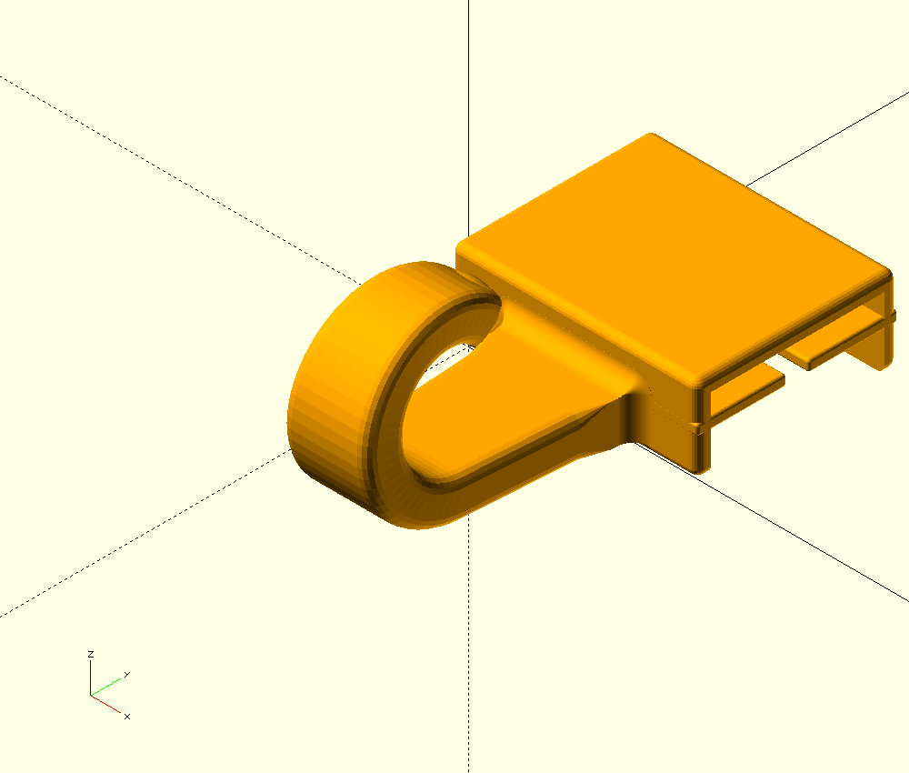

# SlidingRailHook · 滑动首饰挂钩

用于柜门/梳妆台的参数化 H 形滑轨与一体式滑块挂钩，使用 OpenSCAD 建模。



## 旧挂钩兼容轨道 v3：竖打 STL

沿用旧挂钩的 12/8 mm 翼缘、5.8/3.8 mm 厚度配合，只把轨道长度转到打印 Z 轴；不做特殊拼接、不加永久底盘。

- [200 mm 竖打 STL](output/legacy-rail-upright-v3/delivery/legacy-hooks-rail-front8-back12-L200-upright-v3.stl)
- [240 mm 竖打 STL](output/legacy-rail-upright-v3/delivery/legacy-hooks-rail-front8-back12-L240-upright-v3.stl)
- [10 mm Brim、摆放与验证说明](output/legacy-rail-upright-v3/delivery/README.md)

STL 已定向：导入毫米/100%，不要再放平。恒定工字截面没有悬垂支撑需求；底部在切片器加可拆外侧 Brim，先用 200 mm 验证细长件稳定性。下方 v2 的 300 mm 斜放切片包保留为历史方案，不是本次竖打文件。

## 实测配合修正 v2：新挂钩 + 旧挂钩兼容轨道

实物轨道已确认两片翼缘均高 12 mm，外宽 6 mm、内距 4 mm。原 v1 把靠人的翼缘误设为 8 mm，旧挂钩槽因此只有 8.6 mm；**旧版不能安装到这根实物轨道**。

- [新挂钩：一板 12 个，槽净高 12.6 mm](output/fit-12mm-v2/delivery/hook-H12x6-v2-12pcs-PETG-X1C-0p4-0p12.3mf)
- [复用旧挂钩：300 mm 兼容轨道](output/fit-12mm-v2/delivery/legacy-8mm-rail-300-PETG-X1C-0p4-0p20.3mf)
- [先试配：单个新挂钩](output/fit-12mm-v2/delivery/hook-H12x6-v2-1pcs-PETG-X1C-0p4-0p12.3mf)、[50 mm 兼容短轨](output/fit-12mm-v2/delivery/legacy-8mm-rail-50-PETG-X1C-0p4-0p20.3mf)
- [尺寸、打印与验证说明](output/fit-12mm-v2/delivery/README.md)

只交付新挂钩和旧挂钩兼容轨道，不给新挂钩另打印新轨道。按 captive-linear-guide 的真实截面、端部插入和捕获净空核对配合；旧版发布与打印包不覆盖，仍须先试配。

## v0.1.0：根部四角连续补胶

补齐钩子根部 ±X、−Y 与 ±Z 三面交汇处原先的缺口。原有四条 R1.25 凹圆角不再各自收尾，而是通过四块连续转角曲面衔接；转角实体与基座、钩子以及相邻两条胶脚均有正体积重叠。

钩子与滑块属于一体打印件。这里的“焊接”“打胶”是连续实体圆角，不是真实胶水，也不需要把两个 STL 粘起来。

- [最新公开发布与下载](https://github.com/Norman-w/SlidingRailHook/releases/latest)
- [几何验证报告](output/releases/v0.1.0/reports/validation.json)
- [根部等轴近景](output/releases/v0.1.0/renders/root-isometric-axes.png)
- [根部背侧近景](output/releases/v0.1.0/renders/root-underside-axes.png)

## 旧版一板 12 个 · PETG 项目（8 mm 前翼缘，仅历史参考）

- [下载 X1 Carbon / 0.4 mm / PETG / 0.12 mm 已切片 3MF](output/print-12-v1/hook-12-PETG-X1C-0p4-0p12.3mf)
- [打印配置、支撑比较与验证边界](output/print-12-v1/README.md)
- [实际 G-code 支撑路径图](output/print-12-v1/toolpaths-review.png)
- [排版及支撑验证报告](output/print-12-v1/plate-validation.json)

侧放、Snug 紧贴式普通支撑，一板 12 个一体挂钩，不含导轨与端塞。切片估算总耗材 16.6 g（支撑约 2.6 g），约 2 小时 33 分钟。已通过网格、数量、排版、CLI 重开和支撑路径抽样检查；原生 GUI 预览、实物表面、配合与承载仍待确认，未发送打印任务。

## 打印件

| 文件 | 说明 |
|---|---|
| `rail.stl` | 300 mm 轨道，柜门贴装面为 Z=0 |
| `slider_hook.stl` | **合并后的滑块＋挂钩，一体打印**；按需要打印多个 |
| `end_stop_left.stl` | 左端挡块 |
| `end_stop_right.stl` | 右端挡块 |

以上为 v0.1.0 历史文件，位于 `output/releases/v0.1.0/stl/`，也作为 Release 附件提供。本次新挂钩与旧挂钩兼容轨道见顶部 v2 交付。`output/3d-print/`、`output/versions/` 与 `docs/prototype-history.md` 是历史开发记录，不要把旧 `step.stl` 和 `hook_bent.stl` 当作当前的一体打印件。

## 尺寸与装配契约

- 单位：mm。X 沿轨道，Y 向上，Z 为柜门法向；+Z 靠人，挂钩沿 −Y 下垂。
- 当前 v2 参考轨道：长 300，两片翼缘均高 12，外宽 6 / 内距 4，壁厚 1；只用于本次配合验证，不列入打印清单。
- 复用旧挂钩的专用轨道：长 300，靠墙翼缘高 12、靠人翼缘高 8，外宽 5.8 / 内距 3.8，壁厚 1。
- 从轨道端部沿 X 插入滑块，随后安装端挡块。不要从前方硬掰卡入。
- 名义滑动间隙 0.30；补胶保持在外侧根部，不侵入滑动槽。
- 钩身根宽/尾宽 9/4.5、厚 3、直段 12；在 Y–Z 平面向 +Z 弯曲 240°，中心线半径 5。
- 外露截面圆角 0.75，末端椭球端帽长 1.5；根部保留 2 mm 完整连接区。
- 根部四条凹圆角名义 R1.25；下侧适配基座原有 R0.6 圆角，不向门侧基板乱填实体。

尺寸唯一来源是 `src/parameters.scad`。`src/slider_hook.scad` 是一体件导出入口；`src/assembly.scad` 是装配预览入口。单独的 step/hook 模块仅用于设计与诊断。

## 从源码重新生成

需要支持 CGAL 后端的 OpenSCAD，以及 Python 3.12+。以下命令只导出和验证，不连接打印机：

```sh
python3 -m venv .venv
. .venv/bin/activate
python -m pip install -r requirements-qa.txt
sh src/scripts/export_parts.sh
```

默认输出到 `output/build/`。也可以指定一个新的输出目录：

```sh
sh src/scripts/export_parts.sh output/my-build
```

脚本用原生 CGAL 导出 STL，再用 trimesh 检查封闭拓扑、法线、单一连通实体，并用 manifold3d 检查四角正体积连接、完整填充及轨道多位置干涉。`reports/` 内的角块、基座、焊接段等 STL 是诊断体，**不属于打印清单**。

## 验证边界

这是 FDM 原型。上面的打印项目已完成 X1 Carbon / 0.4 mm / PETG / 0.12 mm 的挂钩切片与静态验证，未做实物承载测试。0.30 mm 间隙仍须打印试配；一毫米薄壁、胶带/粘接固定、端挡块保持力、首层、支撑和长期耐久需实际确认。轨道为 300 mm 单件，请先确认打印床能够容纳；12 件挂钩打印项目不包含轨道。

公开仓库和下载文件不代表额定承载、安全认证或实物配合已经通过。
